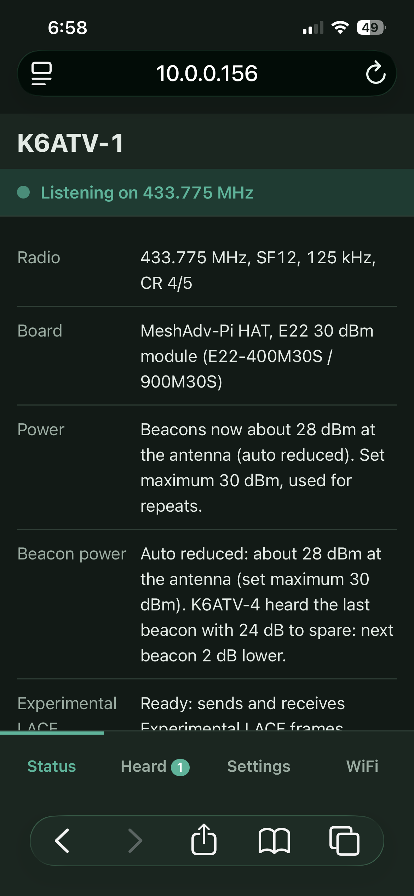

# LoRa APRS Pi

A LoRa APRS station for a Raspberry Pi with a LoRa HAT, set up from your phone.

- Receives standard LoRa APRS packets and the newer, smaller
  [Experimental LACF](https://github.com/radiohound/lora-aprs-ideas) frames
  (LACF for short below; the format is still a draft and may change), and lists
  everything it hears with signal strength, distance and bearing.
- Sends a position beacon in standard format, LACF, or alternating between the two.
- Works as an iGate: passes what it hears to APRS-IS, LACF packets included, so
  LACF stations show up on aprs.fi like any other.
- Can share what it hears with the [LoRa APRS map](https://tiles.aivu.com/lora) over MQTT
  (filled in, off until you tick it).
- Works as a digipeater: fill-in (WIDE1-1) or wide area (WIDE1-1 and WIDE2-N).
  LACF packets are repeated as LACF with this station's signal report added.
- Shows when a digipeater repeats your beacon and, for LACF, how well it heard you.
- Auto reduced power: lowers the beacon power while a digipeater reports a strong
  signal, and raises it again when the margin gets thin.
- Everything is set from a web page that works on a phone, with no internet needed.
- If the Pi can't join WiFi, it starts its own hotspot. Join it from your phone
  and the setup page opens by itself.

This version is a beacon station, receiver, receive-only iGate and digipeater,
with auto reduced power.
Gating messages from APRS-IS back to RF is planned next.

## What you need

- A Raspberry Pi with WiFi: Zero 2 W, 3, 4 or 5
- Raspberry Pi OS Bookworm or newer (Lite is fine)
- A [MeshAdv-Pi HAT](https://github.com/chrismyers2000/MeshAdv-Pi-Hat) with an
  Ebyte E22 module, or another SX1262 / SX1268 board whose pins you can enter
- An antenna on the HAT **before** you transmit
- An amateur radio licence: the station won't transmit until you enter your callsign

## Install

On the Pi:

```bash
git clone https://github.com/radiohound/lora-aprs-pi.git
cd lora-aprs-pi
sudo ./install.sh
```

The installer adds the few packages it needs (all from Raspberry Pi OS, no pip),
turns on SPI, builds the LACF codec, and starts the station as a service. If it
says SPI was just turned on, reboot once.

To update later: `git pull` then `sudo ./install.sh` again. Your settings are
kept, and the station restarts on the new version.

Tip: give the Pi its own name (`sudo raspi-config` → System Options → Hostname),
for example `lora-aprs-pi`, so it's easy to find at `http://lora-aprs-pi.local`
when you have several Pis.

## First setup from a phone

1. If the Pi is already on your WiFi, open `http://<pi-name>.local` on the phone
   (the installer prints the exact address).
2. If not, wait two minutes after power-up, then join the WiFi network
   **LoRa-APRS-Pi** (password `loraaprs`). The setup page should pop up; if it
   doesn't, open `http://192.168.4.1`.
3. On **Settings**: enter your callsign, choose your board, set your position,
   and save.
4. On **WiFi**: pick your home network to put the Pi on it, and change the
   hotspot password.
5. Set a **settings password** if others share your network.

## The page

| Tab | What it shows |
|---|---|
| Status | Whether the radio is listening; the noise floor; radio settings; the power in use (including auto reduced power); APRS-IS login; MQTT; digipeater mode; the GPS, step by step (connected, receiving, position); packet counts, including damaged ones; and the next beacon and status message. **Send beacon now** sends one straight away, and the station's position to APRS-IS. |
| Heard | Every packet, newest first, with signal, distance and bearing, and the raw packet. Tags show the format (Standard or Experimental LACF), **Gated** (sent to APRS-IS), **Repeated** (digipeated), **Sent** (your own transmissions, with their power), and **Your beacon, via …** (your beacon repeated by a digipeater, with its report when there is one). A packet that wasn't gated or repeated says why. |
| Settings | Callsign, beacon (with a picture of the chosen symbol, the comment and status message, and auto reduced power), digipeater, iGate, MQTT, radio, GPS (the serial devices found on the Pi are offered as buttons) and the settings password. Changes apply as soon as you save. |
| WiFi | Join a network, or change and switch to the hotspot. |

The bar under your callsign is the station's lamp: green while listening, amber
just after transmitting, red when the radio has a problem (with the reason).

**Noise floor** is what the receiver hears between packets (seconds when a packet is
arriving are left out), averaged over the last minute. On a MeshAdv E22 board a quiet
site reads about −100 dBm: below −97 shows as quiet, −97 to −85 as a little high, above
−85 as much too high (something near the antenna is drowning out weak stations; see
Troubleshooting).

**GPS** shows three steps, each ticked, waiting or failed: connected (the serial device
opened), receiving (good NMEA sentences arriving, or "garbled: check the baud rate"),
and position (no fix yet with the satellites in view, a rough 2D fix, or a good fix with
the satellites used and HDOP).



## Beacon formats

- **Standard**: `3C FF 01` + text. Every LoRa APRS station can hear it.
- **Experimental LACF**: `3C FF 02` + the compact frame, typically about 40% fewer bytes,
  so less time on air. Only stations that understand LACF can hear it.
- **Alternate**: one of each in turn, so everyone hears you and LACF stations
  get the shorter frame.

Beacons use the plain (uncompressed) position format, which LACF carries in its
lossless position block.

## Comment and status message

- **Send the comment with every … beacons** (Settings → Beacon): 1 puts the comment in
  every beacon. 5 or 10 sends it only on every 5th or 10th, so most beacons are just the
  position: less air time at SF12, and the maps keep showing the last comment.
- **Status message**: an optional short line about the station (up to 62 characters,
  no `|` or `~`), for example `Hill digi + iGate, 433.775 SF12, Experimental LACF`. It is
  sent as an APRS status packet (`>text`) about 15 seconds after the first beacon, then
  every few hours (6 by default), over the air and, with the iGate on, straight to APRS-IS.
  aprs.fi shows it as the station's status. It goes out in Experimental LACF only when the
  beacon format is LACF; otherwise standard.

## Smart Beaconing (moving trackers)

Settings → Beacon → **Smart Beaconing for moving trackers** sets the beacon rate from the GPS
speed instead of a fixed interval, as most trackers do. It uses the methods of
**SmartBeaconing**, the algorithm devised by Tony Arnerich, KD7TA, and Steve Bragg, KA9MVA,
for the HamHUD: the same rules and the same standard settings, written fresh for this
program (no code was copied from another implementation).

- below the **low speed** (3 mph): one beacon every **slow rate** (30 min)
- at the **high speed** (60 mph) or faster: one every **fast rate** (60 s)
- in between, the gap shrinks with speed (fast rate × high speed ÷ speed: every 2 min at
  30 mph), so beacons come about every same distance
- a **turn** sends one at once when the heading changes by more than turn angle + turn
  slope ÷ speed (25° + 255 ÷ 30 = 33° at 30 mph), but never sooner than the **minimum gap**
  (15 s)

It needs a GPS and "Use the GPS position"; while on, "Every (minutes)" is not used. Beacons
from a GPS fix also carry course and speed (`!DDMM.mmN/DDDMM.mmW>090/026…`), so maps show the
direction of travel. Status → Beacon shows the speed, heading and current rate.

## iGate (APRS-IS)

Turn on **Send what this station hears to APRS-IS** under Settings → iGate.
Gating to APRS-IS is for licensed amateurs.

- **Passcode:** leave it empty and the station works it out from its own
  callsign, the same way other APRS software does. Enter one only if you want a
  different one, or -1 for a listen-only login. The Status tab says whether the
  server accepted the login (verified) or not.
- **What gets gated:** every packet heard, except those with NOGATE, RFONLY,
  TCPIP or TCPXX in the path, general queries (`?APRS?`), the station's own
  packets, and repeats of the same packet within 30 seconds. Third-party packets
  are unwrapped and the same rules applied to the packet inside. The Heard tab
  marks each packet **Gated**, or says why it wasn't.
- **LACF:** LACF frames are decoded back to ordinary APRS text before upload.
- **Uploads are tagged `qAO`** (a receive-only iGate), since this version doesn't
  send APRS-IS traffic back over the radio.
- **Its own position** also goes to APRS-IS directly at the beacon interval
  (at least every 10 minutes apart), without using any air time, whether or not
  the radio beacon is on.

## MQTT (the LoRa APRS map)

Settings → **MQTT** sends what this station hears to the
[tiles.aivu.com/lora](https://tiles.aivu.com/lora) map, and lets the developers see how
the network is doing and where problems are: which frame formats arrive, signal strength
and quality (RSSI, SNR, frequency offset), the noise floor, damaged frames, and whether
Experimental LACF frames decode. Every station that reports makes the picture of real
conditions better.

The details are already filled in (server `mqtt.lora-aprs.org`, port `1884`, user `igate`,
password `lora-aprs`, topic `lora-aprs`); tick the box and save. It needs your callsign,
and an internet connection, so it stays quiet while the Pi is on its own hotspot.

- **What it sends**, under `lora-aprs/<your callsign>/`: each packet heard (the same content
  that is on the air and on APRS-IS) with its signal figures; the size and type of each
  frame sent; and a status line each minute (uptime, noise floor, counts). These are the
  same messages the LACF build of the ESP32 iGate sends, so the map treats both alike.
- **What it never sends**: your settings, passwords or WiFi details; packets with RFONLY or
  NOGATE anywhere in the path; and the bytes of damaged frames.
- **Please note**: the connection is not encrypted, and the login is shared and public.
  Untick the box to stop at any time. Status → MQTT shows whether it is connected and how
  many messages have gone.

## Digipeater

Choose under Settings → Digipeater:

| Mode | Repeats |
|---|---|
| Off | nothing |
| Fill-in | `WIDE1-1`, and packets addressed to this station's callsign |
| Wide area | also `WIDE2-1` and `WIDE2-2` |

- The first hop not yet used decides, the same rule spec 11 uses for LACF:
  `WIDE1-1` and `WIDE2-1` become `MYCALL*`, `WIDE2-2` becomes `MYCALL*,WIDE2-1`.
- Never repeated: our own packets, a packet already repeated in the last 30
  seconds, one this station has already repeated (seen in its path), and any
  path that breaks the WIDEn-N rule. Bigger floods (`WIDE3`+) are not served.
- `NOGATE` and `RFONLY` packets **are** repeated: those words mean "keep it on
  RF", not "don't repeat".
- A repeat waits a random 0.5 to 2 seconds, so digipeaters that heard the same
  packet don't all transmit at once.
- **LACF packets** are repeated as LACF by copying their content and adding this
  station's RXT tuple: signal strength, SNR, frequency offset and time to hop.
  Standard packets are repeated as standard text.

## Hearing your beacon repeated

When a digipeater repeats this station's beacon and the station hears the
repeat, the Heard tab marks it **Your beacon, via** the digipeater. If the
repeat is LACF, it also shows the digipeater's report of how well it heard
you (RSSI and SNR), next to how well you heard its repeat.

## Auto reduced power

Settings → Beacon → **Auto reduced power** lowers the beacon's power while a
digipeater reports hearing you with plenty to spare, saving battery and
channel. It works from the digipeater's LACF report, so it needs LACF (or
alternate) beacons, a path such as `WIDE1-1`, and a digipeater in range that adds
a signal report (RXT) when it repeats. Another LoRa APRS Pi does; so do the LACF
builds of the iGate and tracker firmware. Dire Wolf's LACF build repeats LACF
but doesn't add a report yet.

- The margin is the reported SNR above what SF12 (or the set SF) needs, or for
  strong signals the RSSI above the receiver's sensitivity.
- 13 dB or more to spare: the next beacon goes 2 dB lower. 10 to 13 dB: unchanged.
  Under 10 dB: back up by the shortfall plus 2 dB.
- No report for two LACF beacons in a row: straight back to full power.
- Never above the **Maximum power at the antenna** set under Radio, never below
  10 dBm at the antenna. Digipeated packets always go out at the maximum.
- The change is worked out as soon as a report arrives and applies to the next
  beacon. The level is kept across restarts (for up to 6 hours, unless you change
  the maximum).

Where to see it working:
- **Heard:** the "Your beacon, via …" entry shows the report, then
  "Auto reduced power: next beacon about N dBm (this one went out at M dBm)".
- **Status → Power:** "Beacons now about N dBm (auto reduced)" with the reason,
  for example "K6ATV-4 heard the last beacon with 79 dB to spare".
- **Settings → Radio:** a note under the Maximum power box gives the power in use.
- **Heard → Sent** entries show the power each beacon went out at.

To try it, send beacons at least 30 seconds apart: digipeaters skip an identical
packet heard again within 30 seconds, so a quicker second beacon gets no report.

## Transmit power

The page asks for the **maximum power at the antenna**. E22 modules have an
amplifier after the radio chip, so the station sets the chip lower by the
amplifier's gain, and never drives the chip above what the module can take:

| Board | Amplifier | Chip limit | About at the antenna |
|---|---|---|---|
| MeshAdv-Pi, E22 33 dBm (E22-400M33S / 900M33S) | ~25 dB | 8 dBm | up to 33 dBm (2 W) |
| MeshAdv-Pi, E22 30 dBm (E22-400M30S / 900M30S) | ~8 dB | 22 dBm | up to 30 dBm (1 W) |

The default board is the 33 dBm one, because it is the safe guess: a 30 dBm
module set up as a 33 dBm one just runs at low power. The gains are
approximate; measure your output if it matters.

## Radio settings

The defaults are the LoRa APRS standard used in North America and Europe:
433.775 MHz, SF12, 125 kHz, coding rate 4/5, sync word 0x12, CRC on. Every
station you want to hear must use the same frequency, SF, bandwidth and coding
rate.

## Reaching it from elsewhere

- **On the same network**: `http://<pi-name>.local`, or its address (`hostname -I` on the
  Pi shows it).
- **From anywhere**: [Tailscale](https://tailscale.com) gives your own devices a private
  link. On the Pi run `curl -fsSL https://tailscale.com/install.sh | sh`, then
  `sudo tailscale up` and approve it; install the Tailscale app on your phone or computer
  with the same account; then open `http://` and the Pi's 100.x address (`tailscale ip -4`).
  Use the address or the plain hostname: the page refuses other names (such as the long
  `….ts.net` one) on purpose, to protect against DNS rebinding. Set a settings password.
- **A terminal only**: Raspberry Pi Connect (`sudo apt install rpi-connect-lite`, then
  `rpi-connect on`, `rpi-connect signin` and `loginctl enable-linger`) gives a shell on the
  Pi from connect.raspberrypi.com.

## Settings from a terminal

The settings are one file, `/etc/lora-aprs-pi/config.json` (readable by root, as it holds
passwords).

- Read them: `sudo cat /etc/lora-aprs-pi/config.json`, or without passwords
  `curl -s http://localhost/api/settings | python3 -m json.tool`.
- Change one, checked and applied at once, as the page does (add
  `-H 'X-Station-Password: …'` if a settings password is set):
  ```
  curl -s -X POST http://localhost/api/settings -H 'Content-Type: application/json' \
    -H 'Origin: http://localhost' -d '{"digi":{"mode":"wide"}}'
  ```
  It answers `{"errors": {}}`, or names the field that needs fixing.
- Or edit the file (`sudo nano /etc/lora-aprs-pi/config.json`), then restart the station
  with `sudo systemctl restart lora-aprs-pi`. It reads the file only when it starts, and
  saving on the page rewrites it.
- Status: `curl -s http://localhost/api/status | python3 -m json.tool`. Send a beacon now:
  `curl -s -X POST http://localhost/api/beacon -H 'Content-Type: application/json' -H 'Origin: http://localhost' -d '{}'`.
- Log: `journalctl -u lora-aprs-pi -f`.

## Trying it without a Pi

On any computer with Python 3 and a C compiler:

```bash
make            # builds the LACF codec
make test       # runs all the tests
make run        # a pretend radio at http://localhost:8080
```

## Files

| Path | What it is |
|---|---|
| `lora_aprs_pi/sx126x.py` | SX1262 / SX1268 radio driver (spidev + lgpio) |
| `lora_aprs_pi/hardware.py` | Board pin profiles and the power limits |
| `lora_aprs_pi/frames.py` | Standard and LACF frames |
| `lora_aprs_pi/lacf.py` | Python wrapper for the LACF C codec |
| `lora_aprs_pi/aprs.py` | Building beacons, reading received packets |
| `lora_aprs_pi/station.py` | The station: radio loop, heard list, beacons |
| `lora_aprs_pi/igate.py` | APRS-IS connection, passcode, gating rules |
| `lora_aprs_pi/static/symbols/` | The APRS symbol pictures shown in Settings: the [aprs.fi set by OH7LZB](https://github.com/hessu/aprs-symbols), under its own terms (see the README there) |
| `lora_aprs_pi/mqtt.py` | The map feed: event lines and a small MQTT client |
| `lora_aprs_pi/digi.py` | Digipeater path rules and RXT signal reports |
| `lora_aprs_pi/smartbeacon.py` | Smart Beaconing: beacon rate from speed, extra beacons on turns |
| `lora_aprs_pi/power.py` | Auto reduced power |
| `lora_aprs_pi/sim_radio.py` | The pretend radio used by `make run` and the tests |
| `lora_aprs_pi/web.py`, `static/` | The web page and its API |
| `lora_aprs_pi/wifi.py` | WiFi and the hotspot, through NetworkManager |
| `lora_aprs_pi/gps.py` | Optional NMEA GPS on a serial port |
| `lacf/` | The LACF reference codec, copied from lora-aprs-ideas |
| `/etc/lora-aprs-pi/config.json` | Your settings, on the Pi |
| `/etc/lora-aprs-pi/power-state.json` | The auto reduced power level, kept across restarts |

Logs: `journalctl -u lora-aprs-pi -f`

## Troubleshooting

- **"The radio did not answer over SPI"**: SPI isn't on (reboot after
  installing), the HAT isn't seated, or the wrong board is selected.
- **"GPIO nn is in use by another program"**: something else is using the HAT,
  such as meshtasticd or Dire Wolf with LoRa. Stop it first.
- **No hotspot appears**: WiFi needs a country set
  (`sudo raspi-config` → Localisation → WLAN country), and NetworkManager, which
  Raspberry Pi OS Bookworm uses by default.
- **Nothing heard**: check the antenna, and that the frequency, SF, bandwidth and
  coding rate match the stations around you.
- **aprs.fi credits another iGate for a packet this station gated**: APRS-IS keeps
  only the first copy of a packet and drops copies arriving in the next 30 seconds
  or so. Whichever iGate is fastest gets the credit; the Heard tab still says
  Gated.
- **Your digipeating doesn't show on aprs.fi**: same reason. When an iGate hears the
  original directly, the repeated copy arrives later and is dropped as a
  duplicate. Check a nearby station's own log for `MYCALL*` in the path instead.
- **"Your beacon, via …" shows no "heard you at" line**: that digipeater repeated
  your beacon without a signal report (a standard repeat, or a digipeater that
  doesn't add RXT), so auto reduced power can't use it.
- **Beacon power stays at the maximum**: no report has come back yet. See Auto
  reduced power above for what it needs.
- **Noise floor high**: first find whether it comes in through the antenna. With the
  beacon and digipeater off (never transmit without an antenna), unscrew the antenna: the
  reading then is the board's own floor (about −97 dBm on a MeshAdv E22). If it drops a
  lot, something near the antenna or its cable is the source. Common ones: an Ethernet
  cable plugged into the Pi (the biggest one in testing: use WiFi, or a ferrite and
  shielded cable), a nearby power supply, and other 433 MHz radios close by. An SDR shows
  what is on the air: busy 433.92 MHz household sensors 150 kHz away can raise the reading
  without filling the LoRa channel itself.
- **Many packets fail the CRC**: usually weak stations at the edge of what SF12 can hear,
  or a high noise floor (above). Strong packets decoding with a positive SNR means the
  channel itself is fine.
- **GPS step fails**: "not connected" is the device name (try the buttons under the box, or
  unplug and plug in again); "no data" or "garbled" is the baud rate (USB `ttyACM` GPSes
  ignore it; `ttyUSB` and `serial0` ones usually want 9600). With no GPS at the site, leave
  the device box empty.

## Licence

MIT. The LACF codec in `lacf/` is from
[radiohound/lora-aprs-ideas](https://github.com/radiohound/lora-aprs-ideas), also MIT.
